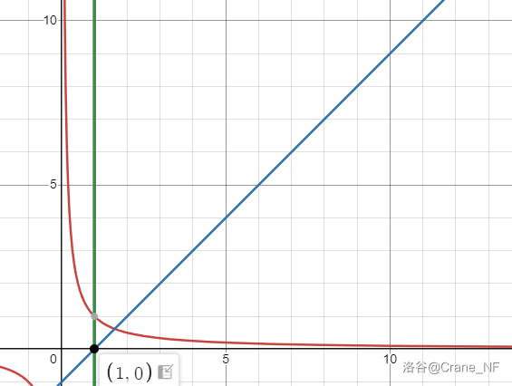
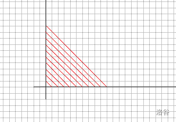
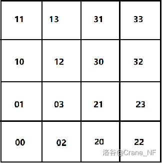
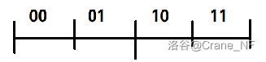

## 一、引入

我们都知道，一条线和一个平面上的点的个数是相等的，都是$\aleph_0$，一个空间也是。（简单介绍无穷级数：无穷也有大小之分，从小到大分别是$\aleph_0 \aleph_1 ... \aleph_n$，其中$\aleph_i = 2 ^ {\aleph_{i-1}}$（也就是前一个的幂集个数）,而每一个无论如果运算都等于自身（比如加减乘除平方等等）。而整数的个数为$\aleph_0$,实数的个数为$\aleph_1$）

如果要直观一点的感受的话，就可以把面想象成一条折叠的线，空间同理。

但更进一步地想，既然是相等的（实质是存在一一对应），那能不能找到一个函数来实现这样的一一对应呢（也就是满映射）？

比如说一条线到平面的映射，其实就是要把一个实数$a$，映射到一个实数点对(x,y)上.

为了方便表达，我们对调一下，把一个实数点对$(x,y)$映射到一个实数$a$上，那这个函数就应该是:

$f(x,y) = a(x,y,a\in R)$ 这样的。

我们就是要把这个$f(x,y)$具体写出来。

给个例子，我们不妨先讨论$x,y,a\in Z$的情况。下面给出一种构造方法：

我们考虑把a化成二进制形式：$ \overline{a_1a_2...a_n} (a=0/1)$，然后把$a_1-a_n$按奇偶分开取出，

这样就产生了两个新数$x=\overline{a_1a_3...}$和$y=\overline{a_2a_4...}$

显然$x,y$都是属于$ \mathbb Z$的。这就是一个简单的构造方法。

我们可以简单感受一下这样的正确性，我们考虑它是否一一对应。显然，一个$a$所对应的$x,y$是固定的，反之亦然。
这就是我们要做的事，当然上面这种不好写出具体的式子，我会尽量给出可以写出式子的做法。

那么上面这些和所谓空间填充曲线有什么关系呢。空间填充曲线，顾名思义地，就是一条布满整个空间的曲线（也就是在实数域内）。注意到其实这就是把实数a映射成实数点对$(x,y)$的一个方法，只是相对我们上面拆解二进制位的方法来说可视性更强（当然也更难找到）。（此外，空间填充曲线很多都是分形（或者说由分形产生），比如说著名的希尔伯特曲线，读者可以自行查阅了解）

## 二、研究路径

循序渐进的，我将由简单的问题开始，由简入深，最后到达我们的目标。

### 1、一维映射

#### (1)、$\mathbb{N}^+ \to \mathbb{Z}$

这个很简单，问题在于要用哪些数去填满负数部分，比如说可以用所有奇数，那么函数就应该是：

$f_1(x)=(-1)^x \cdot \lfloor \frac{x}{2} \rfloor + (x \mod 2)(x \in \mathbb{N})$

因为拿了一半走，所以要除以二。

#### (2)、$\mathbb{R}^+ \to \mathbb{R}$

同样的，我们也要想一想要拿哪一部分去填充负数，下面给出一种比较常见构造：

$$
f(x) = \begin{cases}
-\frac{1}{x} & (0 \lt x \lt 1)\\
x - 2 & (x \geq 1) 
\end{cases}
$$

我们看一看图像就能直观的知道为什么可行

我们相当于是把$y=\frac{1}{x}$小于一的部分关于x轴对称一下，由于这部分是趋近于无穷的，所以可以覆盖满负半轴，除了$(0,-1)$。而$x - 2$就是把缺的一段补上(图中直线是 $ y=x-1 $)

当然，也可以把覆盖任务换一下，两个差不多。

#### (3) $\mathbb Q^+ \to \mathbb Q$

首先，因为$\mathbb Q^+ \subsetneqq \mathbb R^+$，且上面的函数对于有理数是封闭的，所以可以直接用上面的函数

#### (4) $\mathbb N^+ \to \mathbb Q^+$

这个难一些，并且可以引出可数集映射的一个常用套路。

我们不妨从有理数的性质出发。首先，对于任意有理数$a$都可以写成分数形式$a = \frac{p}{q},(p,q) = 1$，假设$p\cdot q = k$。我们可以按照k来对所有有理数分组

设$Q_k$中包含所有满足$p\cdot q = k$的有理数，即

$Q_k = \{ \frac{p}{q} \vert   p,q\in \mathbb N^+ ,(p,q) = 1,p\cdot q = k \} ,\forall k \in \mathbb N^+$

显然，$Q_k$之间是没有交集的，因为一个$a$对应的$p,q$是唯一的，即$\bigcup_{i\neq j,i,j\in \mathbb N^+}Q_i\cap Q_j = \varnothing$

那么，$\mathbb Q^+$就被我们分成了无穷个$Q_k$，即$\mathbb Q^+ = \bigcup_{k=1}^{\infty}Q_k$，而每一个$Q_k$中元素个数是有限个的，比如$Q_1$只有$1$这一个元素，$Q_2$有$2$和$\frac{1}{2}$两个元素，$Q_{12}$有$\frac{1}{12}、12、\frac{3}{4}、\frac{4}{3}$这4个元素

这样划分后，我们可以把所有$Q_k$按照$k$的大小从小到大排列成一行，然后我们一个个地按顺序去数他们的元素，数出$1,2,3,4...$来

各位可能发现了，数出来，其实就是一个映射了，把编号$1,2,3,4...$映射到对应的数上了，而我们数的编号$a \in \mathbb N^+ $，这样，我们就把所有自然数对应到所有正有理数上了，形式化地，我们可以整理一下这样写出：
$$
\text{设:}c_k=Card(Q_k),\forall k \in \mathbb N^+\\
C_k=\sum_{i=1}^{i\leq k} c_i,\forall k \in \mathbb N^+\\
Q_k=\{b_{ki} \vert i\in\mathbb N_{[1,c_k]}\},\forall k \in \mathbb N^+\\
f(x)= b_{nj}\\
\text{满足：}C_{n-1}<x \leq C_n,j = x - C_{n-1},n,j\in \mathbb N^+
$$
虽然式子全部写出来会比较长，但其实是好理解的

但是既然要数，为什么要绕这么一大圈呢，换句话说,我们上面在干什么，或者再换句话说，为什么不能直接数有理数？

原因在于，你不知道下一个数是什么，比如说你数了$1$，那下一个是什么呢？会发现找不到，$1$到$2$间有无数个有理数，这就是为什么直接数不了。而我们所做的这些，就是为了通过划分，使得单个集合内元素个数是有穷的，这样在集合内就可以一个个数了，再直接把所有集合排起来就可以依次数出。

我们所一个个数的编号是属于自然数，个数（基数）是$\aleph_0$，因而将$\aleph_0$称为可数无穷,$\aleph_1$等则是不可数无穷，所有个数为$\aleph_0$的区间都可以仿照着这样来映射到自然数去,当然，不一定是最优方法。

#### (5)、区间的映射

我们上面都是整个数集的映射，我们不妨考虑一下不同区间的映射，其实不比整个数集简单

#### (5).1、$[1,+\infty)\to(-\infty,0)$

其实这个是上面(2)的一种方法中的一部分，之所以单独拎出来讲，是因为它两边区间的开闭不一样，就需要用到一种常用的trick

首先，如果不包含$1$的话其实直接$f(x) = 1 - x$就行，但是多这么一个点，把它放哪里去好呢，不妨找个特殊点的地方，因为这样好写方程，不妨把它放到$2$去,那$2$放哪里呢，不妨把它放到3去，以此类推，我们发现可以一直放下去，(其实就是所有整数整体后移了一位)，如此，我们就把$1$安排好了，函数如下:

$$
f(x)=\begin{cases}
-x &x\in \mathbb Z_{>0}\\
1-x & x \in \bigcup_{i=1}^{\infty} \mathbb R_{(i,i + 1)}
\end{cases}
$$

#### (5).2、$(0,1)\to(0,1]$
这个就更明显了，考虑从哪里找出一个点来填上$1$,同时也能不断的有点一个个填补空缺，(找某个特殊的无限序列进行整体移动)，我们可以考虑$2$的负整数幂，写出的方程如下:
$$
f(x)=\begin{cases}
2x & x\in \bigcup_{i=1}^{\infty}2^{-i}\\
x & x\in (0,1)-\bigcup_{i=1}^{\infty}2^{-i}
\end{cases}
$$

那么同理，底数换成任意整数都可以

#### (5).3、$(0,1]\to[0,1]$

这个和上面差不多，思路是一样的，下面给出一种构造：
$$
  f(x) = \begin{cases}
    0 &x=\frac{1}{3}\\
    3x & x \in \bigcup_{i=2}^{\infty}3^{-i}\\
    x & x\in (0,1]-\bigcup_{i=1}^{\infty}3^{-i}
  \end{cases}
$$

#### (5).4、$(0,1)\to[0,1]$
注意到我们$4.3$这里使用$3$做底数，这样，我们就可以和上面$4.2$的函数结合一下，就能实现了，但我们也可以简单一点的，如下：

$$
f(x)=
\begin{cases}
0 & x=\frac{1}{2}\\
4x & x\in\bigcup_{i=2}^{\infty}2^{-i}\\
x & (0,1)-\bigcup_{i=1}^{\infty}2^{-i}
\end{cases}
$$

#### (6)、$任意区间\to\mathbb R$

既然任意区间内实数"个数"都是$\aleph_1$，那么理论上就可以把任意区间映射到全体实数上，只需要使用恰当的函数。比如下面这种

我们考虑把数字化为 $13$ 进制，那么每一位上就应该是 $0 1 2 3 4 5 6 7 8 9 A B C$ 这十三种之一，我们不妨把 $0-9$ 称为数码

考虑区间内这一种数，它的某一位是 $C$ 而后面（右边）都是数码，并且左边有不止一个字母且左边第一个字母不为 $C$ ， 假设为 $B$ ，我们可以把这一个 $B$ 左边的数全部去掉，把 $C$ 换成小数点，最左边的 $B$ 换成负号,如果是 $A$ 则为正。这样我们就用一个十三进制数构造出了一个十进制数

对于区间内的其他数我们全部映射到 $0$

形式化地

$$
\text{若}x = \overline{....Bx_1x_2...x_nCy_1y_2...(后面都是数码)},\forall x_i,y_i \in \{ 0,1,2,3,4,5,6,7,8,9 \}\\
\text{则}f(x) = -\overline{x_1x_2...x_n}.\overline{y_1y_2...}\\
\text{若}x = \overline{....Ax_1x_2...x_nCy_1y_2...(后面都是数码)},\forall x_i,y_i \in \{ 0,1,2,3,4,5,6,7,8,9 \}\\
\text{则}f(x) = \overline{x_1x_2...x_n}.\overline{y_1y_2...}\\
\text{对于其他}x\\
f(x) = 0
$$

这就是大名鼎鼎的康威十三进制函数，它的值域是全体实数，实际上，它在任意非退化区间(即左端点小于右端点)上的值域都是$\mathbb R$！

拥有如此强的性质其实不难理解，因为它看的只是从某一位起后面的数字，那么对于任意一个实数，我们把小数点换成 $C$ ，正负换成 $A$ 或 $B$后，左边是可以任意加的，我们可以通过改变左边的情况来把它移动到任意位置去

当然这是个单射，不符合我们要求，但是我在搜资料是被它惊艳到了，还是决定介绍一下，而且对于我们后面的探究也有帮助
### 2、2维映射
#### (1)、$\mathbb{N}^+ \to \mathbb{N^+}^2$

考虑将自然数映射成自然数点对。

同样的，我们也可以考虑二进制，把$a(a\in \mathbb{N})$的二进制按奇偶分开，形成两个新数$x$,$y$

不过我们可以考虑另一种更加直观的映射方式像这样

从 $0$ 开始，一层一层地排开，比如 $1$ 就应该对应着 $(0,0)$ , $2$ 是 $(0,1)$ , $3$ 是 $(1,0)$ ，以此类推

通过找规律不难得出以下式子：

令
$$
\begin{align*}
b &= \lfloor \frac{\sqrt{8\cdot a - 7} - 1}{2}\rfloor \\

c &= \frac{b^2 + b}{2}
\end{align*}
$$
则映射出
$$
a=(x,y),
\begin{cases}
x = b + c - a + 2\\

y = a - c
\end{cases}
,a,x,y,a,b\in \mathbb N^+
$$
各位不妨想一想这里算出来的 $b$ 和 $c$ 有什么意义，想出来也就可以理解上面的规律是什么

这是其中一种方法，下面介绍另一种

如果我把 $a$ 对应的坐标设成 $(p,q)$ 各位有没有想到什么。我们上面再进行有理数的映射时，是把有理数化成了 $\frac{p}{q}$ 的形式，那我们这里把 $(p,q)$ 对应到 $a$ 是不是可以想象成是 $a$ 拆出了 $p$ 和 $q$ ,那就和上面对应起来了，我们完全可以仿照有理数的方法把 $(p,q)$ 对应到 $a$ 上，这里就不再把式子列出来了。

#### (2)、$\mathbb{Z} \to \mathbb{Z}^2$

其实我们不用重新推一个，我们前面推出来的两个函数其实是可以嵌套的，我们可以先逆用第一个函数将$\mathbb{Z}$映射到$\mathbb{N}^+$,然后再用第二个函数将$ \mathbb{N}^+$映射到$ \mathbb{N^+}^2$,再将求出的x,y套一层第一个函数将$ \mathbb{N}^+$映射到$\mathbb{Z}$。这样就完成了

#### (3)、 $\mathbb Q_+ \to \mathbb Q_+^2$

同样的，对应有理数，我们也考虑化成分数，把 $(x,y)$ 化成 $(\frac{p_1}{q_1},\frac{p_2}{q_2})$,可以再次用划分集合的方法把它映射到一个整数 $b$ 上，然后再把整数映射到有理数上，用上面的函数就行。

#### (4)、$\mathbb R\to \mathbb R^2$

首先最简单的，可以考虑转成二进制后奇偶分位，直接拆成两个数，分别作为横纵坐标，这是一个双射

其次，我们可以考虑把它化成十三进制后再奇偶分，分出来两个再分别用康威函数映射出横纵坐标，当然这就有点多此一举了。

再其次，我们可以先考虑一个正方形，把它平分成4个小正方形，分别编号 $0 1 2 3$ ，对于小正方形也做如此操作，无限迭代下去，那么对于原先的正方形中每一个点，就可以看成是由一个个正方形细分出来的，就可以由此对应到一个四进制数上

(图为迭代两次后各区域的编号)

具体地，我们可以这样写出
$$
\text{对于四进制数} a=\overline{a_1a_2...}\\
\text{其对应的x,y为}\\
\begin{cases}
x = \sum2^{-i}(a_i\geq2)\\
y = \sum2^{-i}(a_i\mod2=1)
\end{cases}
$$

此时，$x$ 和 $y$ 的范围都是 $[0,1]$ 所以我们要再做一次映射把它们映射到 $\mathbb R$上，但我们还要把 $a$ 映射到 $\mathbb R$ 上

我们可以照葫芦画瓢地，先把 $a$ 化成二进制，然后可以考虑把一条线段每次平分两段，$0$ 取左边, $1$ 取右边，那么对应到的应该是

$$
a = \overline{a_1a_2...},\forall a_i \in \{ 0,1\} \\
b = \sum 2^{-i}(a_i=1)
$$

(图为迭代两次后的编号)

最后再把 $b\in [0,1]$ 映射到全体实数就行

## 结语

上面探究了若干个映射，虽然没能达到一开始的目标：找到按照空间填充曲线方式进行一维到二维映射的函数，毕竟这确实比较困难，就连 $\mathbb R \to \mathbb R^2$ 的映射都很难找到有具体函数式的。

上面大都只是简单介绍一下构造的方法，限于水平，没有做严谨的证明，欢迎指正
